# data-clutch

A desktop SQL and Redis client for servers that allow **one session at a time**, in the spirit of DataGrip.

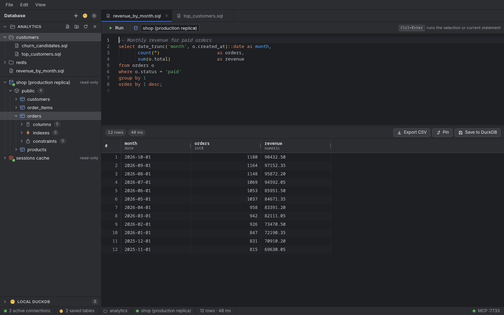

> Screenshots in this manual use a fictitious demo database (a small online shop).

- **One connection per database**, owned by a single goroutine: jobs are queued, keepalive pings run while idle, and a dead connection is re-dialed with backoff, never in parallel. A server that accepts a single session is never hit with a second one.
- **Read-only by default.** Postgres connections run in `READ ONLY` transactions. Redis connections only accept commands from an allowlist built from `COMMAND INFO`.
- **Scripts live in folders.** Open a folder of `.sql` / `.redis` files and each file becomes a tab, with unsaved-changes tracking, autosave and external-change detection.
- **Local DuckDB.** Save any query result into a local DuckDB file and query it again offline.
- **Built-in MCP server.** Lets an AI client explore the tables you saved in DuckDB, read-only. It can never reach your Postgres or Redis connections.
- Dark, light or system theme, remappable shortcuts, CSV export of the loaded rows or of the full query.

## Contents

1. [Install and run](#install-and-run)
2. [A tour of the window](#a-tour-of-the-window)
3. [Connections](#connections)
4. [Writing and running queries](#writing-and-running-queries)
5. [Working with script folders](#working-with-script-folders)
6. [Results: export, pin, save to DuckDB](#results-export-pin-save-to-duckdb)
7. [Redis](#redis)
8. [Local DuckDB](#local-duckdb)
9. [Settings](#settings)
10. [Keyboard shortcuts](#keyboard-shortcuts)
11. [MCP server](#mcp-server)
12. [Where your data lives](#where-your-data-lives)
13. [Safety model](#safety-model)
14. [Development](#development)

## Install and run

There are no prebuilt releases yet, so build it from source. You need:

- Go 1.26+
- Node.js 20.19+ and npm (required by Vite 7)
- the [Wails v2 CLI](https://wails.io/docs/gettingstarted/installation) (`go install github.com/wailsapp/wails/v2/cmd/wails@latest`)
- Linux only: the WebKitGTK 4.1 development package (for example `libwebkit2gtk-4.1-dev` on Debian/Ubuntu, `webkit2gtk4.1-devel` on Fedora)

```bash
git clone https://github.com/lucasfantacuzzi/data-clutch.git
cd data-clutch
wails build -tags webkit2_41      # the binary lands in build/bin/
# or, for hot reload while developing:
wails dev -tags webkit2_41
```

On macOS and Windows the `-tags webkit2_41` flag is not needed. The app has been developed and tested on Linux; the macOS and Windows builds follow the same Wails setup but have not been exercised there.

To try it without a server of your own, start the sample databases:

```bash
docker compose up -d     # Postgres on :55432 (password "clutch"), Redis on :56379
```

## A tour of the window

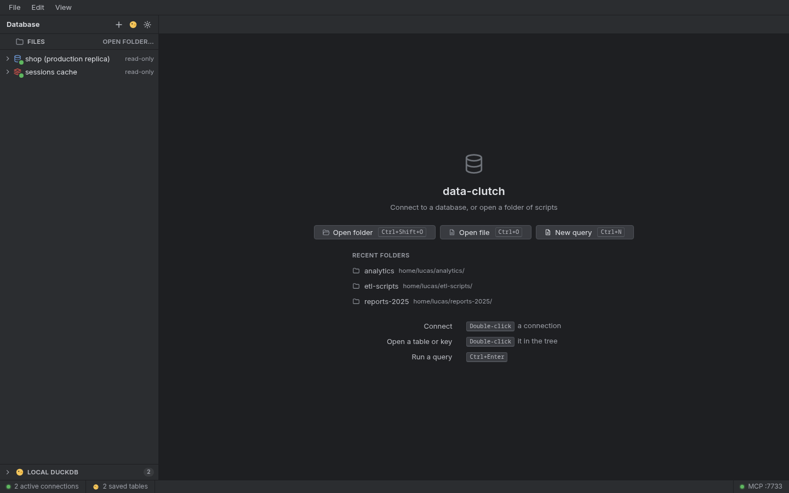

On first launch you see the welcome screen. From here you can open a folder of scripts, open a single file, start a new query, or jump back into a recent folder.

The window has five areas:

| Area | What it does |
| --- | --- |
| **Menu bar** (top) | File, Edit and View menus. Everything also has a shortcut. |
| **Sidebar** (left) | A **Files** section for the open script folder, your **connections** with their schemas and tables (or Redis keys), and **Local DuckDB** at the bottom. Drag its right edge to resize it; `Ctrl+B` hides it. |
| **Tabs** (top of the workspace) | One tab per query, file, Redis key or DuckDB console. A dot next to the title means unsaved changes. |
| **Editor and results** | The SQL editor on top, the result grid below. |
| **Status bar** (bottom) | Active connections, saved DuckDB tables, the open folder, the connection of the current tab, the last result's row count and time, and the MCP port. |

## Connections

Click **+** in the sidebar header to add one.

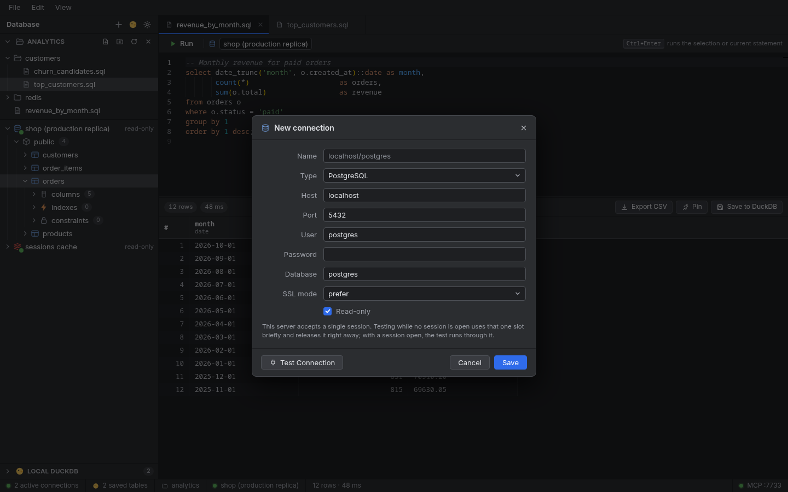

- Choose **PostgreSQL** or **Redis**. Host, port, user, database (or Redis DB index) and SSL mode are filled with sensible defaults.
- **Read-only** is ticked by default and is what you want for production. Untick it only on connections where you intend to write.
- **Test Connection** checks the settings. When the server allows a single session, the test uses that slot briefly and releases it. If a session is already open, the test runs through it instead.
- Passwords are stored in the operating-system keyring (Keychain on macOS, Credential Manager on Windows, the Secret Service such as GNOME Keyring or KWallet on Linux). See [Where your data lives](#where-your-data-lives) for what happens when no keyring exists.

**Double-click** a connection to connect. A green dot means it is ready. Right-click a connection for **Connect**, **New console**, **Refresh schema** (**Reload keys** on Redis), **Disconnect**, **Edit…** and **Delete**. When a connection drops, the app reconnects with backoff and shows the countdown in the tree; **Retry now** in the same menu skips the wait.

Expanding a Postgres connection shows its schemas, tables, columns, indexes and constraints. Double-click a table to open a tab with `select * from <table> limit 200` already run.

## Writing and running queries

Each tab has a **Run** button, a connection picker and the editor.

- `Ctrl+Enter` runs the **selection**, or the **current statement** when nothing is selected. `Shift+Enter` does the same.
- For Redis the current **line** is the command.
- `Esc` cancels a running query. The connection slot is released straight away.
- The editor completes keywords, table names and column names from the connected schema.
- Up to **1000 rows** are loaded per run by default. Change it in [Settings](#settings).

A new query tab or a file tab starts with **Choose connection…**. The connection is **not** saved inside your `.sql` file, so the same script can be pointed at staging today and at a replica tomorrow.

### Destructive statements ask first

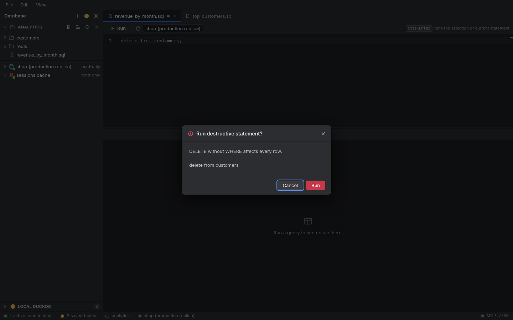

`DROP`, `TRUNCATE`, `DELETE` or `UPDATE` without a `WHERE`, and Redis `FLUSHALL` ask for confirmation before they run. Cancel is the default button. You can turn this off in Settings → Query. Read-only connections additionally refuse writes on the server side.

## Working with script folders

Use **File → Open folder…** (`Ctrl+Shift+O`) and pick a folder. Its `.sql` and `.redis` files appear in the **Files** section of the sidebar, and the app remembers the folder across restarts.

- **Double-click** a file to open it in a tab. `Ctrl+S` saves, `Ctrl+Shift+S` saves under a new name.
- **Go to file** (`Ctrl+P`) fuzzy-searches every script in the folder.

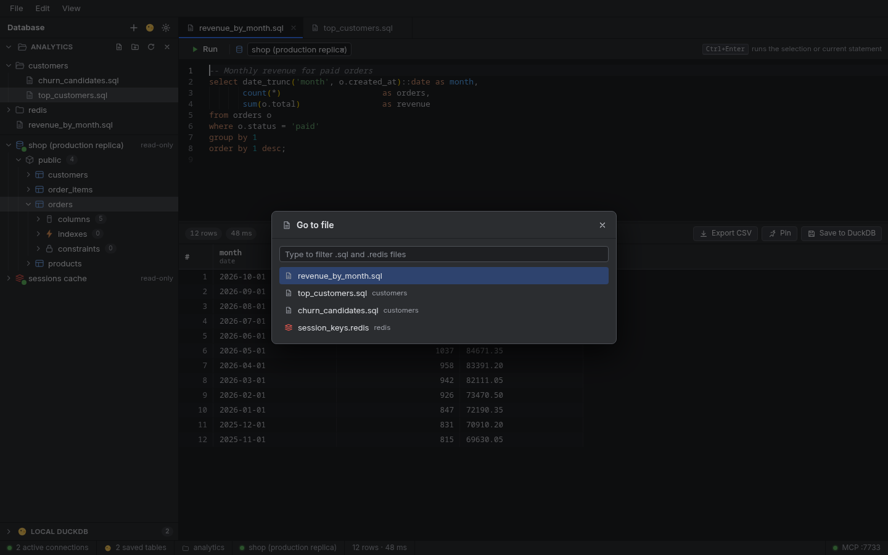

- **Right-click** a file or folder for the context menu:

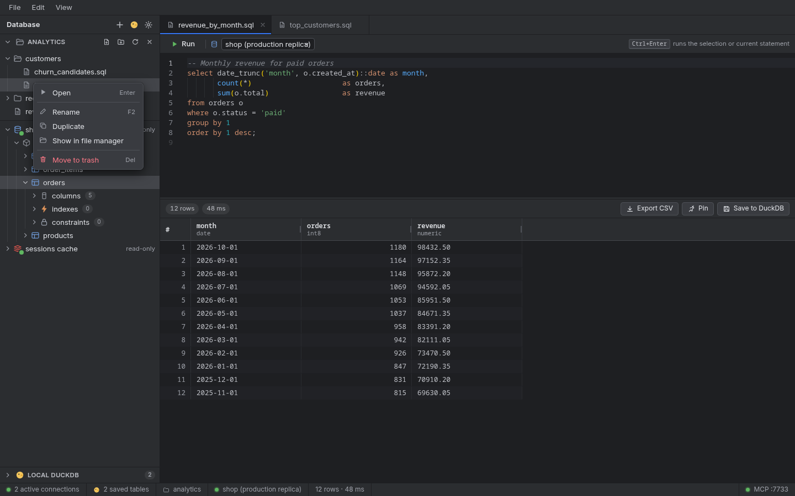

  | Action | Shortcut |
  | --- | --- |
  | Open | `Enter` |
  | Rename | `F2` |
  | Duplicate | |
  | Show in file manager | |
  | Move to trash | `Del` |

  Deleting always goes to the **system trash**, never straight to permanent deletion. Right-clicking a folder (or the empty area) also offers **New SQL file**, **New Redis file** and **New folder**; the same actions are the small icons next to the folder name. You can **drag** a file onto a folder to move it.
- A dot next to a tab title means there are unsaved edits. Closing such a tab asks what to do:

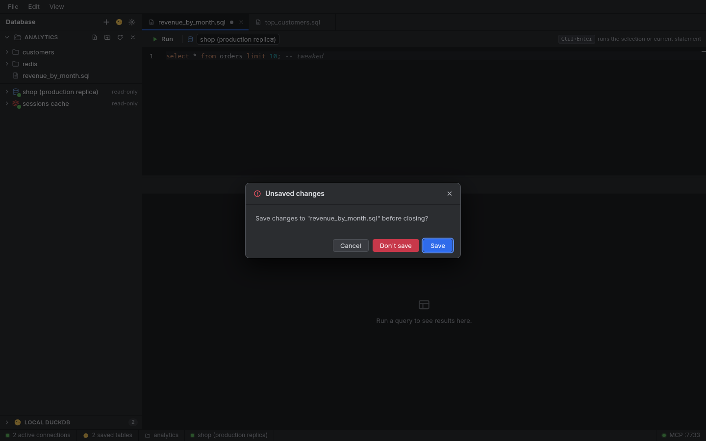

- **Autosave** is optional (Settings → Editor). When on, file tabs are written one second after you stop typing.
- **External changes** are noticed. If another program edits a file you have open, a tab without unsaved edits reloads silently; a tab with unsaved edits asks whether to reload.
- **Sessions are restored.** Quit with three tabs open and they come back next time, including edits you had not saved yet. Query results are not restored, only the text.

You can also open one-off files outside the folder with **File → Open file…**; the app may read and write only the folder you opened and files you picked in the system dialog.

## Results: export, pin, save to DuckDB

The result bar above the grid shows the row count and the elapsed time, and has three buttons.

### Export CSV

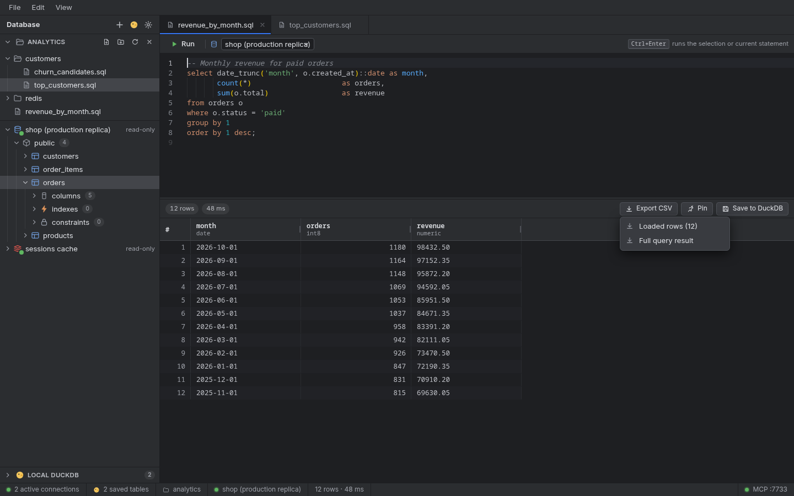

- **Loaded rows** writes what is in the grid right now.
- **Full query result** runs the statement again and streams **every** row into the file, not only the loaded ones. This uses the same single connection slot and can be cancelled.

Both ask where to save through the native file dialog. The file is written to a temporary name and renamed when finished, so a cancelled or failed export never leaves a half-written CSV.

### Pin

**Pin** keeps the current result in a pinned strip. Later runs in the same tab do not overwrite it, which makes it easy to compare two versions of a query.

### Save to DuckDB

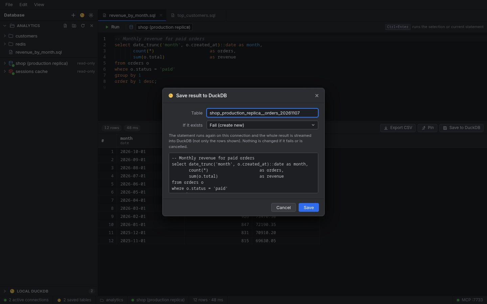

Copies the **whole** result into a table of the local DuckDB file. The statement runs again and is streamed, so you get every row rather than only the first page. Choose what happens if the table exists:

- **Fail (create new)** leaves everything untouched and reports the error.
- **Replace** drops the old table first.
- **Append rows** adds to it.

Nothing is changed if the run fails or is cancelled.

## Redis

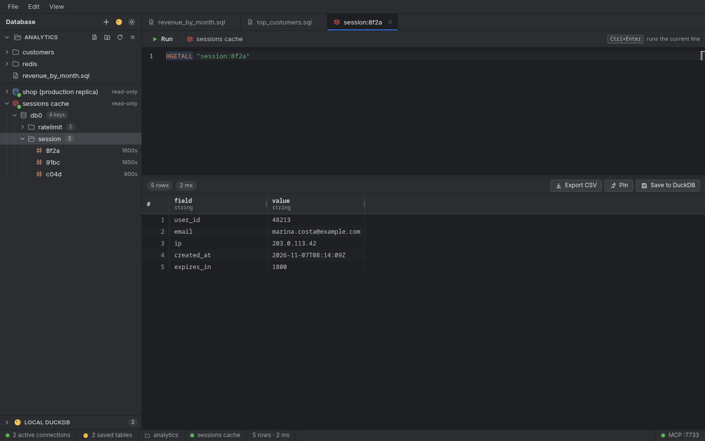

Expanding a Redis connection shows its databases. Keys are grouped by the `:` separator, with their type icon and remaining TTL. Large keyspaces are loaded in pages with **Load more…**. Double-click a key to open a tab with the right command for its type (`GET`, `HGETALL`, `LRANGE`, `SSCAN`, `ZRANGE`, `XRANGE`). You can also write commands yourself in a `.redis` file or a new tab; the connection's read-only allowlist applies.

## Local DuckDB

The **Local DuckDB** section at the bottom of the sidebar lists the tables you saved, with their row counts. Right-click one to **Open data** or **Drop table…**. The **DuckDB console** button (the yellow icon in the sidebar header) opens a tab where you can run SQL against all of them.

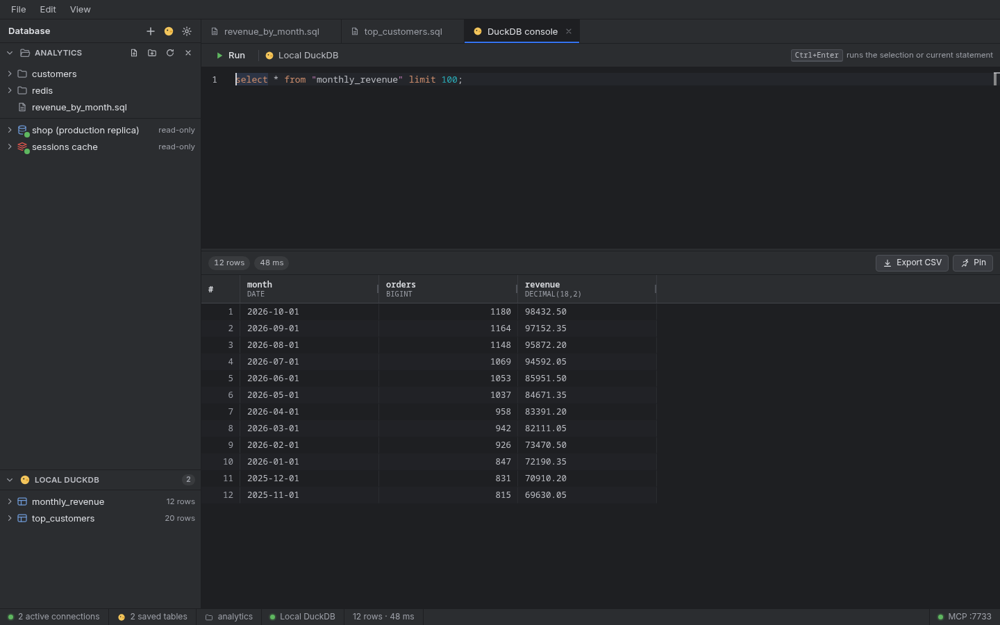

Saved tables remember where they came from (connection, statement, time), which the MCP server can report back to an AI client.

## Settings

Open Settings with `Ctrl+,`, the gear in the sidebar header, or **File → Settings…**. Changes apply immediately and are saved automatically.

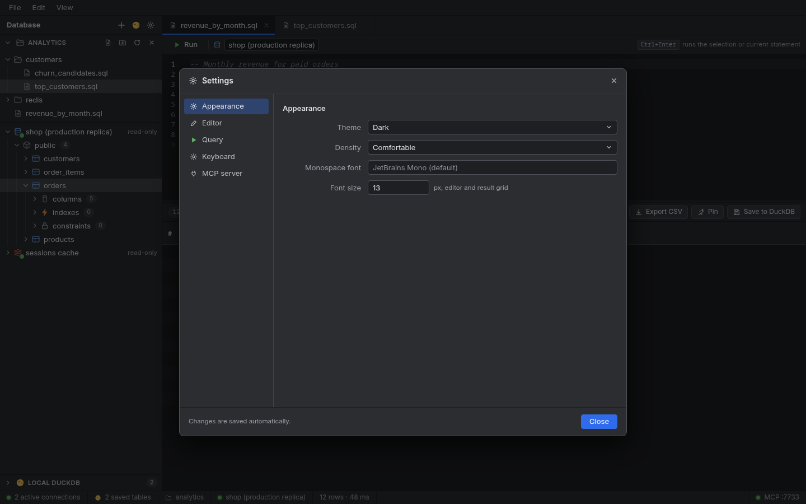

| Section | Options |
| --- | --- |
| **Appearance** | Theme (dark, light, follow system), density (comfortable or compact), monospace font family and size (applies to the editor and the grid). |
| **Editor** | Word wrap, minimap, line numbers, tab size, autosave for file tabs. |
| **Query** | Row limit per run (1 to 100000), timeout (0 to 3600 seconds, 0 means none), confirmation for destructive statements. |
| **Keyboard** | Rebind any shortcut. See below. |
| **MCP server** | Enable the server, change the port, copy the connection snippets. See [MCP server](#mcp-server). |

The theme also has a shortcut in **View → Dark / Light / Follow system**.

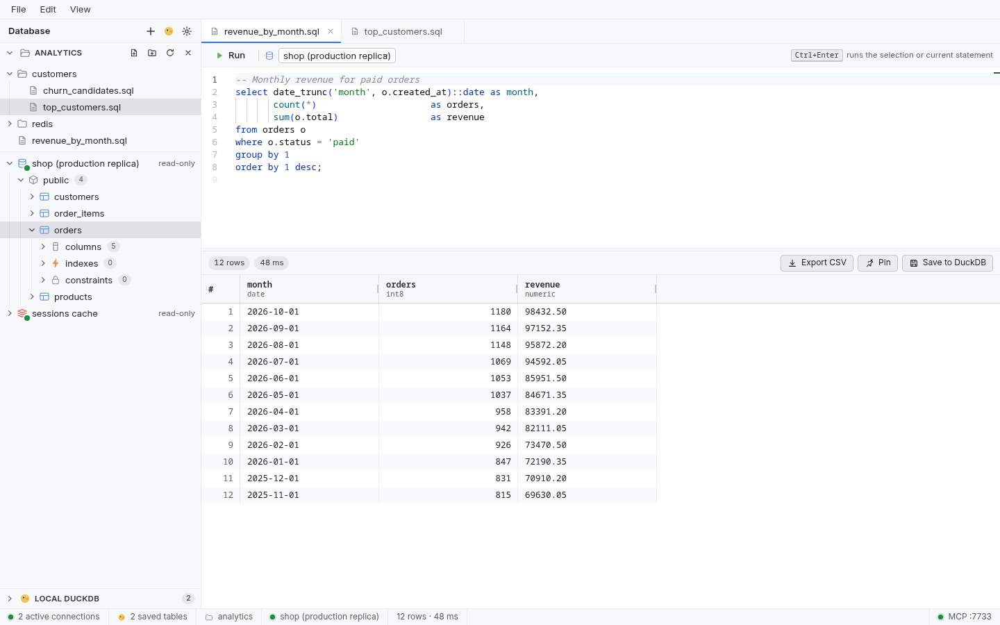

The query timeout cancels the query through the driver. A server that ignores cancellation keeps running it, so treat the timeout as protection for the client's single slot rather than as a guarantee about the server.

## Keyboard shortcuts

Every shortcut below is a default and can be remapped.

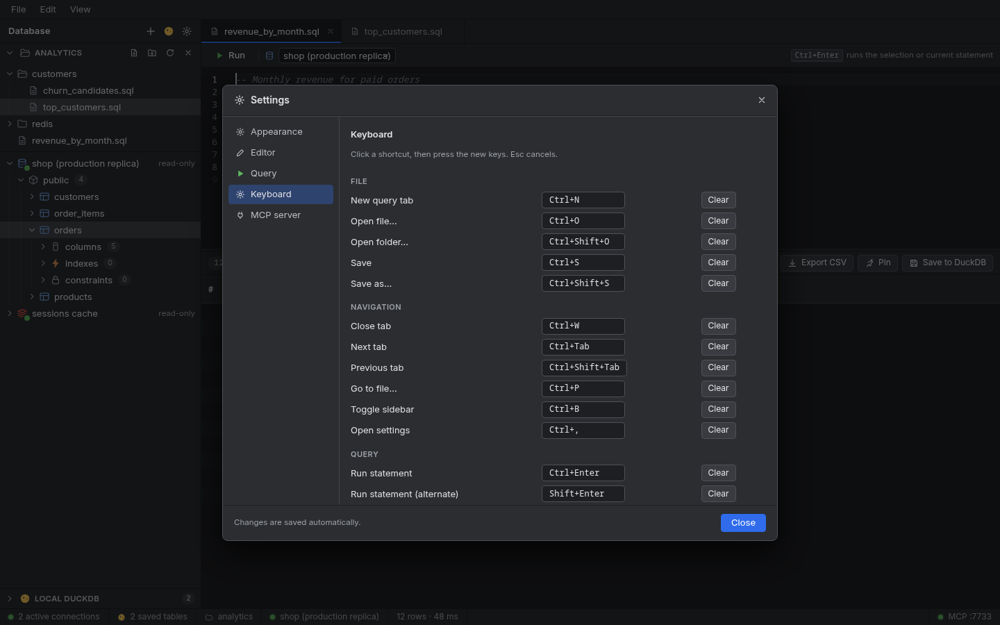

Click a shortcut, then press the new keys; `Esc` cancels. If the combination is already taken, the dialog tells you which command uses it and does not apply the change. **Clear** unbinds a command and **Reset** restores its default.

| Command | Default |
| --- | --- |
| New query tab | `Ctrl+N` |
| Open file | `Ctrl+O` |
| Open folder | `Ctrl+Shift+O` |
| Save | `Ctrl+S` |
| Save as | `Ctrl+Shift+S` |
| Close tab | `Ctrl+W` |
| Next / previous tab | `Ctrl+Tab` / `Ctrl+Shift+Tab` |
| Go to file | `Ctrl+P` |
| Toggle sidebar | `Ctrl+B` |
| Open settings | `Ctrl+,` |
| Run statement | `Ctrl+Enter` |
| Run statement (alternate) | `Shift+Enter` |
| Cancel running query | `Esc` |

On macOS the shortcuts that use `Ctrl` here use `⌘` instead (`Ctrl+Tab` keeps `Ctrl`).

## MCP server

The embedded [Model Context Protocol](https://modelcontextprotocol.io) server lets an AI assistant look at the tables you saved in DuckDB. It listens on `127.0.0.1` only, requires a bearer token, and runs every query read-only.

1. Open Settings → **MCP server** and tick **Enabled**. The default port is `7733`.
2. Press **Copy** next to *Claude Code* and run the command in a terminal, or copy the JSON for another client.

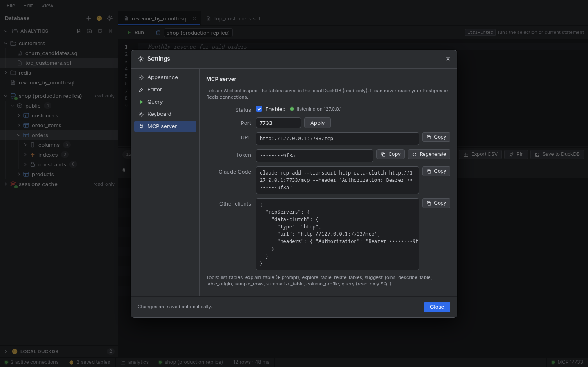

The token is kept in the OS keyring, not in `settings.json`, and the screen shows it masked. The **Copy** buttons copy the real value. **Regenerate** invalidates the old token immediately; clients must be reconfigured with the new one. If no keyring is available, the screen shows a warning because the token and your connection passwords then fall back to a `0600` file.

Tools exposed: `list_tables`, `explain_table` (also available as a prompt), `explore_table`, `relate_tables`, `suggest_joins`, `describe_table`, `table_origin`, `sample_rows`, `summarize_table`, `column_profile` and `query` (read-only SQL).

## Where your data lives

Everything is under the per-user config directory, in a `data-clutch` folder:

| OS | Location |
| --- | --- |
| Linux | `~/.config/data-clutch/` |
| macOS | `~/Library/Application Support/data-clutch/` |
| Windows | `%AppData%\data-clutch\` |

| File | Contents |
| --- | --- |
| `connections.json` | Connection settings, without passwords. |
| `settings.json` | Preferences, MCP port and enabled flag. No secrets. |
| `session.json` | Open tabs, their text and the active tab. |
| `approved.json` | Files you picked in system dialogs, which the app may reopen. |
| `data.duckdb` | The local DuckDB with your saved results. |
| `logs/app.log` | Application log. |
| `secrets.json` | **Only** when no OS keyring is available: connection passwords and the MCP token, in plain text with `0600` permissions. |

Connection passwords and the MCP token go to the OS keyring first. `secrets.json` exists only as a fallback for systems without one (a headless Linux box, for example), and the MCP screen warns you when it is in use.

## Safety model

- **Single session.** All work on a database goes through one queue. Queries never run in parallel against the same server.
- **Read-only connections** use `READ ONLY` transactions on Postgres and a command allowlist on Redis.
- **Confirmation** before destructive statements, on by default.
- **Filesystem sandbox.** The app can read and write only inside the folder you opened, plus files you chose in a native dialog. Paths that climb out of the folder with `..` or through symlinks are refused.
- **Trash, not delete.** Removing a file moves it to the system trash.
- **MCP is isolated.** It sees only the local DuckDB, never the live connections, and only with read-only SQL.

## Development

```bash
wails dev -tags webkit2_41                  # run with hot reload
cd frontend && npm run build                # type-check and build the frontend
go vet ./... && go test -race ./...         # backend tests
```

Run the integration tests against real servers with:

```bash
docker compose up -d
CLUTCH_PG=localhost:55432 CLUTCH_REDIS=localhost:56379 go test -race ./...
```

Layout:

| Path | What is in it |
| --- | --- |
| `app*.go`, `main.go` | The Wails app and the methods exposed to the frontend. |
| `internal/conn` | The single-session connection owner, queue, keepalive and reconnect. |
| `internal/pg`, `internal/redisx` | Postgres and Redis drivers. |
| `internal/duck` | Local DuckDB and the read-only query guard. |
| `internal/store` | Connections, settings, preferences and the secret store. |
| `internal/workspace` | The sandboxed filesystem layer and the folder watcher. |
| `internal/mcpsrv` | The MCP server. |
| `frontend/src` | The React interface (Monaco, AG Grid). |

After changing an exported method of `App`, regenerate the bindings with `wails generate module`.
